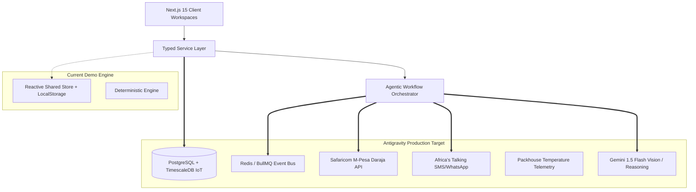
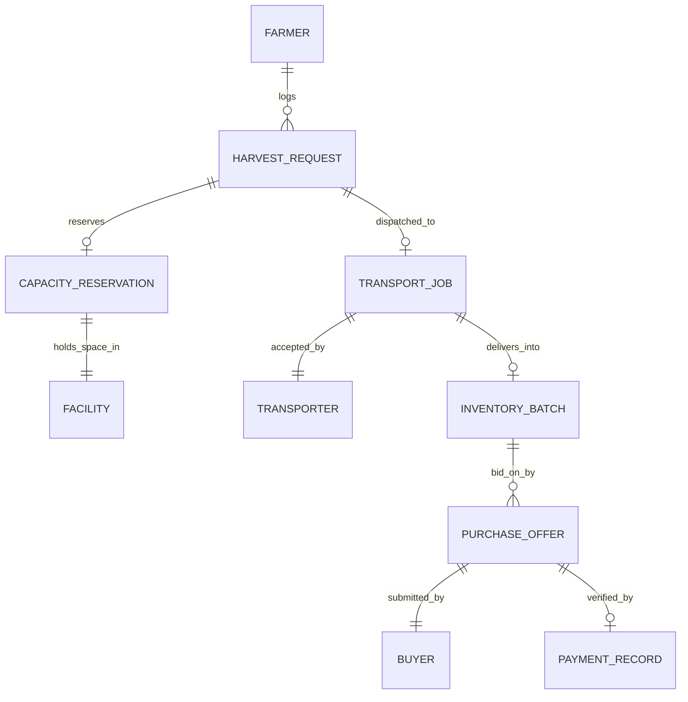

# KAVANDOR — Production Backend Handoff Document
> **Target Engineering Platform:** Google Antigravity (AGY)  
> **Prepared For:** Next-Phase Production Backend Engineering  
> **Initial Operating Geography:** Kisii and Nyamira Counties, Kenya  
> **Domain:** Post-Harvest Cold-Chain Logistics, Transport Coordination, and Commodity Marketplace  

---

## 1. Product & Domain Overview
KAVANDOR coordinates the fragmented agricultural post-harvest journey for perishable crops (tomatoes, avocados, bananas, leafy greens) in Kenya. It connects smallholder farmers to suitable solar-hybrid cold storage, dispatches local rural transporters (boda-boda, pickup, 3-ton trucks), manages atomic capacity ledgers, and connects stored batches with commercial wholesale buyers under secure multi-state escrow.

---

## 2. Architecture & Boundary Design



The frontend strictly calls typed domain services (`IHarvestService`, `IStorageService`, `ITransportService`, `IInventoryService`, `IBuyerService`, `IWorkflowOrchestrator`). **Not a single UI component directly mutates database records.** 

---

## 3. Domain Models & Key Relationships



### Critical Domain Invariants
1. **Capacity Conservation:**
   $$\text{Total Capacity} = \text{Available} + \text{Reserved} + \text{Occupied}$$
   A reservation does NOT equal occupied space. Only verified check-in at the packhouse weighbridge shifts kilograms from `Reserved` to `Occupied`.
2. **Weight Reconciliation:**
   Farmer reported weight is provisional. The official batch weight is measured by the electronic scale at facility intake. If $|\text{weighed} - \text{reported}| / \text{reported} > 0.05$, an automated `QUANTITY_DISCREPANCY` exception is raised.
3. **Financial vs. Physical Separation:**
   An accepted offer does not release produce. Release requires verified M-Pesa escrow and physical operator inspection.

---

## 4. Entity State Machines

### Harvest Request Lifecycle
`SUBMITTED` $\to$ `ASSESSED` $\to$ `RESERVED` $\to$ `DISPATCHED` $\to$ `COLLECTED` $\to$ `RECEIVED` $\to$ `STORED` $\to$ `CLOSED`

### Transport Job Lifecycle
`AVAILABLE` $\to$ `ACCEPTED` $\to$ `EN_ROUTE_PICKUP` $\to$ `ARRIVED_PICKUP` $\to$ `COLLECTED` $\to$ `IN_TRANSIT` $\to$ `DELIVERED` $\to$ `RECONCILED`

### Purchase Offer & Escrow Lifecycle
`SUBMITTED` $\to$ `ACCEPTED` $\to$ `ESCROW_VERIFIED` $\to$ `RELEASE_AUTHORIZED` $\to$ `COLLECTED`

---

## 5. Logical Agent Responsibilities & Permissions

| Agent / Service | Responsibility | Allowed Tools | Escalation Boundary |
| :--- | :--- | :--- | :--- |
| **Harvest Intake Agent** | Normalizes form data, validates units, resolves village coordinates. | `validatePayload()`, `geocodeVillage()` | Halts on missing required fields. |
| **Crop Assessment Agent** | Analyzes harvest photo for skin turgor, defects, and shelf-life urgency. | `callGeminiVision()`, `validateSchema()` | Optical evaluation only; cannot alter pricing. |
| **Storage Matching Agent** | Ranks cold hubs by crop compatibility, distance, rate, and reliability. | `queryFacilityLedgers()`, `rankFacilities()` | Escalates if no facility has available capacity. |
| **Capacity Reservation Service** | Atomically decrements available capacity and holds dock slot. | `atomicDecrement()`, `setExpiryTimer()` | Strictly deterministic; no LLM override. |
| **Transport Dispatch Agent** | Broadcasts haulage load to eligible carriers by vehicle class. | `queryTransporters()`, `broadcastSMS()` | Escalates if unaccepted after 45 minutes. |
| **Delivery Monitoring Service** | Tracks milestone timestamps and GPS pings. | `recordMilestone()`, `checkSLA()` | Raises `DELIVERY_DELAYED` on 30m overrun. |
| **Inventory Reconciliation** | Weighed intake verification, grading, and batch issuance. | `recordScaleReading()`, `issueBatch()` | Flags discrepancy if $> 5\%$ delta. |
| **Buyer Matching Agent** | Matches active batches to buyer procurement specs; combinator. | `matchOrders()`, `proposeConsolidation()` | Sourcing suggestion only; no auto-transfer. |
| **Supervisor & Exception Agent**| Continuous loop monitoring pipeline health and exception remediation. | `reassignJob()`, `adjustLedger()`, `escalate()` | Cannot bypass explicit financial gates. |

---

## 6. Proposed Production API Mappings

```
POST   /api/v1/harvests                 -> Create harvest & trigger intake
GET    /api/v1/harvests/:id             -> Retrieve harvest & live milestone trace
POST   /api/v1/harvests/:id/assess      -> Run multimodal vision assessment
POST   /api/v1/reservations             -> Atomic capacity lock at facility
POST   /api/v1/transport/jobs/:id/accept -> Carrier accepts haulage job
PATCH  /api/v1/transport/jobs/:id/status -> Transition delivery milestone
POST   /api/v1/facility/intake          -> Electronic weigh-in & batch creation
GET    /api/v1/marketplace/batches      -> Query verified cold-stored batches
POST   /api/v1/buyer/sourcing/combine   -> Run multi-batch aggregation algorithm
POST   /api/v1/offers                   -> Submit commercial buyer offer
POST   /api/v1/offers/:id/respond       -> Farmer accepts or declines offer
POST   /api/v1/offers/:id/escrow        -> M-Pesa Daraja escrow deposit callback
POST   /api/v1/offers/:id/release       -> Packhouse release sign-off
POST   /api/v1/offers/:id/collect       -> Outbound truck collection confirmation
GET    /api/v1/ops/telemetry            -> Live network metrics and health
GET    /api/v1/ops/exceptions           -> List open exceptions
POST   /api/v1/ops/exceptions/:id/remedy-> Execute operator remediation
```

---

## 7. Antigravity Phased Implementation Roadmap

### Phase 1: Database & ORM Scaffolding
- Deploy PostgreSQL with PostGIS extension for spatial distance calculations between Kisii/Nyamira villages and cold hubs.
- Initialize Prisma schema replicating the domain models in `src/domain/`.

### Phase 2: Microservice API Adapter
- Create HTTP client adapter in `src/services/HttpBackendAdapter.ts` matching the interfaces implemented in `KavandorStore.tsx`.
- Switch Next.js client providers from local mock storage to the production endpoints.

### Phase 3: Telemetry & M-Pesa Daraja Integration
- Connect IoT sensors in Nyakoe, Manga, Nyamira, and Masaba packhouses to publish temperature and humidity readings every 60 seconds over MQTT to TimescaleDB.
- Integrate Safaricom Daraja STK Push for buyer escrow settlement and automated B2C payout disbursements to farmers and transporters.
