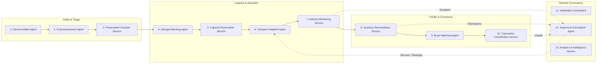

# KAVANDOR — Agentic Intelligence Skillset & Orchestration Contract

## 1. Overview of the 13 Autonomous & Deterministic Services

The KAVANDOR Agentic Architecture decomposes complex agricultural supply chain coordination into 13 specialized services and agents. Each service has strictly bounded inputs, outputs, allowed tools, and escalation triggers.

---

## 2. Detailed Agent Specifications

### 2.1 Harvest Intake Agent
- **Trigger:** Farmer completes form submission or sends payload.
- **Tools Allowed:** `validateCropPayload()`, `normalizeUnits()`, `resolveFarmGeolocation()`.
- **Invariants:** Cannot invent missing quantities or farm locations. If mandatory fields are missing, pauses workflow with `AWAITING_FARMER_INPUT`.

### 2.2 Crop Assessment Agent (AI / Vision)
- **Trigger:** Image payload received from intake.
- **Provider:** Google Gemini Vision (Multimodal) via server-side route `/api/ai/assess` with deterministic fallback.
- **Output Contract:**
  - `cropName`: Detected crop (e.g. "Roma Tomato", "Hass Avocado", "Giant Cavendish Banana")
  - `conditionGrade`: `A_PRIME` | `B_STANDARD` | `C_PROCESSING` | `REJECT`
  - `visibleDefects`: Array of observations (e.g. "mild skin bruising", "green shoulder", "early blight spotting")
  - `urgencyLevel`: `LOW` | `MEDIUM` | `HIGH` | `CRITICAL` (estimated hours before quality degradation)
  - `confidenceMetric`: Explicit basis of observation; zero hallucinated percentages.
  - `recommendedAction`: Prompt preservation / immediate pre-cooling vs direct local sale.
- **Tools Allowed:** `callVisionModel()`, `validateAssessmentSchema()`. Cannot alter financial terms.

### 2.3 Preservation Decision Service
- **Trigger:** Validated assessment completed.
- **Logic:** Evaluates storage economics: `Estimated Recovered Value > (Storage Fee + Transport Fee)`.
- **Output:** Recommendation to store vs. sell immediately at farmgate if transport/storage would result in net loss.

### 2.4 Storage Matching Agent
- **Trigger:** Positive preservation recommendation.
- **Logic:** Evaluates candidate facilities within 30km radius (Kisii & Nyamira), filtering by compatible cold-chain zone (e.g. Tomatoes: 12-15°C, Avocados: 4-7°C), available capacity, daily rate (KES/crate/day), and historic reliability rating.
- **Output:** Top-ranked primary facility + 1 eligible alternative with auditable rationale.

### 2.5 Capacity Reservation Service
- **Trigger:** Farmer confirms recommended facility.
- **Logic:** Atomically decrements `availableCapacityKg` and increments `reservedCapacityKg` on the facility ledger. Sets 4-hour lock window.
- **Invariants:** AI cannot book capacity. Booking requires explicit command and state validation.

### 2.6 Transport Dispatch Agent
- **Trigger:** Confirmed storage reservation.
- **Logic:** Identifies nearby registered transporters with appropriate vehicle type (Boda-boda crate rig for <= 150kg, Pickup for <= 1,000kg, Light truck for > 1,000kg).
- **Output:** Creates `TransportJob` in `AVAILABLE` state and dispatches notification.

### 2.7 Delivery Monitoring Service
- **Trigger:** Transporter advances job milestones (`ACCEPTED` -> `EN_ROUTE_PICKUP` -> `COLLECTED` -> `IN_TRANSIT` -> `DELIVERED`).
- **SLA Supervision:** Flags milestone as `OVERDUE` if elapsed time exceeds predicted route duration by > 45 minutes, raising an exception to the Supervisor.

### 2.8 Inventory Reconciliation Service
- **Trigger:** Transporter marks `DELIVERED` at facility.
- **Logic:** Packhouse intake operator scales load, logs observed grade, and confirms check-in.
- **Discrepancy Rule:** If `|weighedKg - requestedKg| / requestedKg > 0.05` (5%), raises `QuantityDiscrepancyException` while creating batch with actual weighed weight. Converts reservation to occupied capacity.

### 2.9 Buyer Matching Agent
- **Trigger:** New active inventory batch created.
- **Logic:** Matches stored batch attributes (crop, grade, volume, location) against buyer purchase orders and historical procurement targets.
- **Combinator Rule:** Consolidates multiple smallholder batches (e.g., 200kg + 180kg + 150kg = 530kg) to satisfy wholesale buyer orders (> 500kg).

### 2.10 Transaction Coordination Service
- **Lifecycle States:** `OFFER_SUBMITTED` -> `OFFER_ACCEPTED` -> `ESCROW_PAYMENT_VERIFIED` -> `RELEASE_AUTHORIZED` -> `COLLECTION_CONFIRMED`.
- **Invariants:** 
  - Acceptance does NOT release inventory.
  - Release requires verified payment record and operator sign-off.

### 2.11 Notification Coordinator
- **Channels:** In-app reactive notification drawer + simulated SMS / WhatsApp dispatch payloads for field roles.

### 2.12 Supervisor & Exception Agent
- **Responsibilities:** Continuous health loop scanning active workflows.
- **Exception Classes:** `NO_FACILITY_CAPACITY`, `TRANSPORTER_NO_SHOW`, `DELIVERY_DELAYED`, `QUANTITY_DISCREPANCY`, `PAYMENT_UNVERIFIED`, `OFFER_EXPIRED`.
- **Permitted Remediation Actions:** `retryStorageMatch()`, `reassignTransporter()`, `adjustBatchWeight()`, `escalateToHumanOperator()`.

### 2.13 Analytics & Network Intelligence Service
- Aggregates operational throughput, cold-chain utilization %, average transit time, and commercial settlement value in KES.
