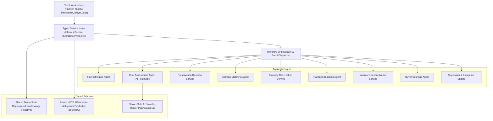

# KAVANDOR — Architecture & System Design

## 1. High-Level System Architecture



---

## 2. Directory & Folder Structure

```
kavandor/
├── context/                        # 9 JS Mastery Context Files + Agentic Skillset
│   ├── project-overview.md
│   ├── architecture.md
│   ├── build-plan.md
│   ├── code-standards.md
│   ├── library-docs.md
│   ├── ui-tokens.md
│   ├── ui-rules.md
│   ├── ui-registry.md
│   ├── progress-tracker.md
│   └── agentic-skillset.md
├── src/
│   ├── app/                        # Next.js App Router Pages & Layouts
│   │   ├── layout.tsx              # Root Layout with Font & Meta
│   │   ├── page.tsx                # High-Impact Editorial Landing Page & Live Demo
│   │   ├── farmer/                 # Farmer Workspace
│   │   │   ├── page.tsx            # Farmer Dashboard / Home
│   │   │   ├── harvest/new/page.tsx # Harvest Submission Flow (Photo + Details)
│   │   │   ├── harvest/[id]/page.tsx # Harvest Tracking & Timeline View
│   │   │   ├── storage/page.tsx    # Stored Produce Batches
│   │   │   ├── offers/page.tsx     # Received Buyer Offers
│   │   │   └── activity/page.tsx   # Farmer Event History
│   │   ├── facility/               # Cold Facility Workspace
│   │   │   ├── page.tsx            # Facility Dashboard (Capacity & Incoming)
│   │   │   ├── reservations/page.tsx # Capacity Ledger & Reservations
│   │   │   ├── deliveries/page.tsx # Deliveries Queue & Intake Verification Check-in
│   │   │   ├── inventory/page.tsx  # Active Batches & Releases
│   │   │   ├── collections/page.tsx # Authorized Buyer Pickups
│   │   │   └── settings/page.tsx   # Temperature, Zones & Pricing Config
│   │   ├── transporter/            # Transporter Workspace (Mobile-First)
│   │   │   ├── page.tsx            # Active Jobs & Next Move
│   │   │   ├── jobs/page.tsx       # Available Haulage Marketplace
│   │   │   ├── jobs/[id]/page.tsx  # Step-by-Step Delivery Execution Flow
│   │   │   └── history/page.tsx    # Completed Deliveries & Earnings
│   │   ├── buyer/                  # Buyer & Cooperative Workspace
│   │   │   ├── page.tsx            # Buyer Procurement Dashboard
│   │   │   ├── marketplace/page.tsx # Verified Inventory Search & Filters
│   │   │   ├── listings/[id]/page.tsx # Batch Details & Offer Submission
│   │   │   ├── offers/page.tsx     # Active Offers & Lifecycle States
│   │   │   ├── sourcing/page.tsx   # Consolidated Multi-Batch Sourcing Wizard
│   │   │   └── purchases/page.tsx  # Confirmed Orders & Releases
│   │   ├── ops/                    # Operations Intelligence Command Center
│   │   │   ├── page.tsx            # Operational Health & Live Flow Visualizer
│   │   │   ├── activity/page.tsx   # Full Automation Trace & Agent Tasks
│   │   │   ├── exceptions/page.tsx # Exception Management & Remediation Action
│   │   │   └── audit/page.tsx      # Chronological System Audit Log
│   │   └── api/                    # Server-side Route Handlers
│   │       ├── ai/assess/route.ts  # Vision Crop Assessment Route
│   │       ├── ai/explain/route.ts # Decision Explanation Route
│   │       └── state/route.ts      # Server persistence / backup
│   ├── components/                 # Bespoke Component Library
│   │   ├── common/                 # Header, Navigation, Role Switcher, Logo SVG
│   │   ├── ui/                     # Badges, Buttons, Cards, Modals, Progress
│   │   ├── landing/                # Hero, Workflow Simulation, Editorial Showcase
│   │   ├── farmer/                 # Crop Photo Upload, Triage Card, Facility Card
│   │   ├── facility/               # Capacity Meter, Check-in Modal, Batch Drawer
│   │   ├── transporter/            # Milestone Transition Stepper, Load Card
│   │   ├── buyer/                  # Batch Card, Offer Form, Sourcing Combinator
│   │   └── ops/                    # Trace Inspector, Exception Resolver, Metric Tile
│   ├── domain/                     # Pure TypeScript Domain Models & Interfaces
│   │   ├── harvest.ts
│   │   ├── facility.ts
│   │   ├── transport.ts
│   │   ├── inventory.ts
│   │   ├── buyer.ts
│   │   ├── workflow.ts
│   │   ├── exception.ts
│   │   └── audit.ts
│   ├── services/                   # Typed Business Logic & Agents
│   │   ├── HarvestService.ts
│   │   ├── StorageService.ts
│   │   ├── TransportService.ts
│   │   ├── InventoryService.ts
│   │   ├── BuyerService.ts
│   │   ├── OrchestratorService.ts
│   │   ├── ExceptionService.ts
│   │   └── NotificationService.ts
│   ├── store/                      # Shared Reactive Demo Repository
│   │   ├── state.ts                # Initial Seed Data (Kisii/Nyamira)
│   │   ├── store.tsx               # Context Provider with Persistence & Event Bus
│   │   └── useKavandorStore.ts     # Hook for Consumers
│   └── lib/                        # Utilities & Helpers
│       ├── ai/                     # Gemini / Mock AI Adapters
│       ├── currency.ts             # KES Formatter
│       ├── geo.ts                  # Kisii/Nyamira Route Distances
│       ├── id.ts                   # Deterministic & Random ID Generator
│       └── validation.ts           # Zod Schema Definitions
├── public/                         # Public Assets, Crisp SVG Pictograms, Natural Photos
├── BACKEND_HANDOFF.md              # Production Antigravity Roadmap
└── package.json
```

---

## 3. Core Domain Entities & Invariants

### Invariant 1: Separation of Financial & Physical Realities
- An accepted offer does **not** mean payment has cleared.
- A verified payment does **not** equal physical release.
- A physical pickup requires release authorization from the facility operator.

### Invariant 2: Capacity Atomic Ledger
- Total Facility Capacity = Available Capacity + Reserved Capacity + Occupied Capacity.
- A reservation transitions to "Occupied" strictly upon verified facility check-in.
- Reservations automatically expire if the transport job is cancelled or exceeds SLA without arrival.

### Invariant 3: Single-Sourced Verification
- Produce quantity entered by the farmer is provisional (`requestedQuantityKg`).
- Official inventory quantity (`verifiedQuantityKg`) is determined at check-in by the packhouse scale. Any delta raises a `QuantityDiscrepancyException`.
