# KAVANDOR — Phased Build Plan

## Phase Overview & Verifiable Milestones

```mermaid
gantt
    title KAVANDOR Build Execution
    dateFormat  X
    axisFormat %s

    section Scaffolding & Setup
    Project Init & Dependencies       :0, 1
    Context Files & Standards         :1, 2
    
    section Core Infrastructure
    Domain Models & Zod Schemas       :2, 3
    Design Tokens & Bespoke CSS       :3, 4
    Shared Store & Seed Data          :4, 5
    
    section Critical Path Workflows
    Landing Page & Live Demo Runner   :5, 6
    Farmer Harvest & Cold Matching    :6, 7
    Transporter Haulage Flow          :7, 8
    Facility Intake & Batch Ledger    :8, 9
    Buyer Marketplace & Sourcing      :9, 10
    
    section Operations & Intelligence
    Ops Intelligence Command Center   :10, 11
    Exception Resolution Engine       :11, 12
    AI Route & Provider Abstraction   :12, 13
    
    section Validation & Handoff
    Browser Verification & Testing    :13, 14
    Backend Handoff Documentation     :14, 15
```

---

## Detailed Phases & Verifiable Done Criteria

### Phase 1: Environment, Dependencies & Context Files
- **Tasks:**
  - Create project workspace `kavandor` with Next.js 15 App Router, TypeScript, Tailwind CSS, Lucide icons.
  - Establish all 9 JS Mastery Context Files + Agentic Skillset in `/context`.
- **Done Criteria:** App builds cleanly, `/context` files complete and cross-referenced.

### Phase 2: Domain Models, Store & Seed Data
- **Tasks:**
  - Implement TypeScript domain models (`Harvest`, `Facility`, `TransportJob`, `InventoryBatch`, `Offer`, `WorkflowTask`, `ExceptionRecord`).
  - Seed realistic Kisii/Nyamira data:
    - Nyakoe Cold Hub (Kisii Central)
    - Manga Solar Packhouse (Kitutu Chache)
    - Nyamira AgriCenter (Nyamira Town)
    - Masaba Cold Vault (Masaba South)
  - Create reactive React Context store with localStorage persistence and full state transition reducers.
- **Done Criteria:** State updates trigger cross-role reactivity without page reloads.

### Phase 3: Bespoke Design System & Visual Identity
- **Tasks:**
  - Define custom palette in CSS variables: Electric Orange (`#FF5A1F`), Charcoal (`#17191D`), Warm Paper (`#F6F3EC`).
  - Build geometric SVG symbol & wordmark (monochrome, dark, and light variants).
  - Create reusable UI primitives: Badges, Buttons, Cards, Modals, Steppers, Stat Counters.
- **Done Criteria:** Zero generic dashboard aesthetics; warm, editorial, human yet technologically authoritative feel.

### Phase 4: Public Landing Page & Interactive Proof
- **Tasks:**
  - Hero section: "Every harvest has a next move."
  - Interactive "Live Product Flow Visualizer": Run a harvest from farmgate to buyer in 60 seconds with live state updates.
  - Demo role switcher navbar (Switch between Farmer, Facility, Transporter, Buyer, Ops with one click).
- **Done Criteria:** Visitors immediately grasp the product ambition and can trigger a deterministic live run.

### Phase 5: Farmer Experience (`/farmer`)
- **Tasks:**
  - `/farmer/harvest/new`: Photo upload with live AI crop triage, condition detection, cold facility ranking, and transport cost estimate.
  - `/farmer/harvest/[id]`: Status timeline (Assessment -> Confirmed -> Pickup -> In Transit -> Stored).
  - `/farmer/storage`: Stored inventory batches, daily storage fee counter, and buyer offer alerts.
  - `/farmer/offers`: Review buyer bids, accept or negotiate.
- **Done Criteria:** Complete harvest creation to reservation confirmation in under 3 minutes.

### Phase 6: Transporter Mobile Workspace (`/transporter`)
- **Tasks:**
  - `/transporter/jobs`: Available agricultural haulage jobs with distance, cargo type, and payout in KES.
  - `/transporter/jobs/[id]`: Working transition buttons (Accept -> En Route -> Arrived at Farm -> Produce Collected -> En Route to Facility -> Delivered).
  - Updates propagate live to Farmer and Facility screens.
- **Done Criteria:** Advancing transport state reflects immediately in the farmer's timeline.

### Phase 7: Facility Operator Workspace (`/facility`)
- **Tasks:**
  - `/facility`: Visual capacity gauge (Available vs. Reserved vs. Occupied).
  - `/facility/deliveries`: Incoming queue and one-click Intake Check-in Modal (records actual weighed kg, observed condition, discrepancy detection).
  - `/facility/inventory`: Active batches with zone allocations, release states, and storage duration.
- **Done Criteria:** Intake check-in automatically creates an inventory batch and frees transport job.

### Phase 8: Buyer Marketplace & Sourcing (`/buyer`)
- **Tasks:**
  - `/buyer/marketplace`: Search & filter verified cold-stored crops by county, grade, and volume.
  - `/buyer/sourcing`: Multi-batch combinator (e.g. buyer needs 500kg tomatoes; platform combines 200kg + 180kg + 150kg).
  - `/buyer/offers`: Multi-state offer lifecycle (Submitted -> Accepted -> Escrow Verified -> Release Authorized -> Collected).
- **Done Criteria:** Sourcing engine combines fragmented smallholder batches into institutional orders.

### Phase 9: Operations Intelligence Command Center (`/ops`)
- **Tasks:**
  - Real-time telemetry: Live active workflows, capacity utilization, aggregate haulage fees.
  - Automation Activity: Trace inspector showing logical agents (Intake, Assessment, StorageMatch, Dispatch, Reconciliation, BuyerMatch).
  - Exceptions Inbox: Realistic failure remediation (e.g., transporter delay, weight discrepancy, capacity overflow) with working mock actions.
  - Audit Trail: Immutable chronological event stream with filtering by actor type (System, Agent, Human).
- **Done Criteria:** Complete operational visibility with no black-box automation.

### Phase 10: Provider Abstraction, Backend Handoff & Browser Verification
- **Tasks:**
  - API routes for optional Gemini Vision inference with deterministic fallback.
  - Comprehensive `BACKEND_HANDOFF.md` for Google Antigravity.
  - Automated browser subagent verification of end-to-end user journeys.
- **Done Criteria:** Zero console errors, fully working end-to-end flow, complete handoff documentation.
